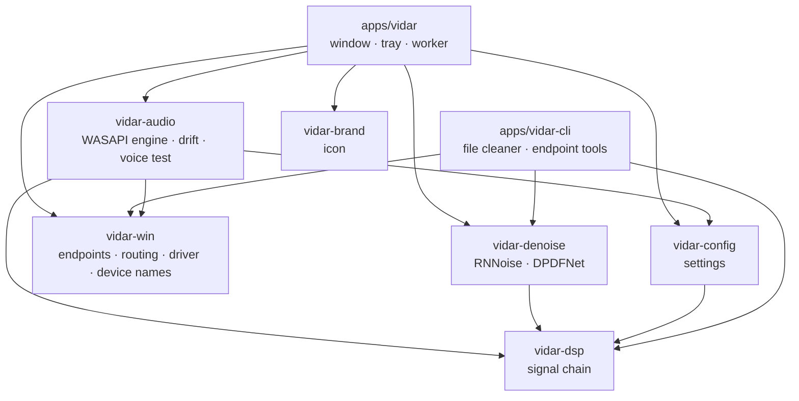

# Development

## Building

You need Windows 10 (1809 or later) or 11 on x86-64, [Rust](https://rustup.rs) (stable) and
the Visual Studio C++ build tools.

```shell
cargo xtask fetch        # RNNoise weights, DPDFNet models, ONNX Runtime, each checked against SHA-256
cargo build --release    # target\release\vidar.exe and vidar-cli.exe
cargo test --workspace
```

`cargo xtask fetch` downloads into `third_party/rnnoise/model/`, `third_party/onnxruntime/`
and `models/`. All three are git-ignored.

To try the live app you also need the virtual cable. Start `vidar.exe` and press **Install
virtual microphone**, or run `vidar-cli endpoints install-driver` from an elevated prompt. It
looks for the driver in `drivers\vbcable` next to the executable. See
[How it works](how-it-works.md#the-virtual-cable) for why Vidar uses VB-Audio's signed driver
rather than its own.

## Layout



| Path | What |
|---|---|
| `apps/vidar` | Desktop app: window (eframe), tray, background worker, autostart |
| `apps/vidar-cli` | File cleaner, plus the endpoint and driver tools the app runs elevated |
| `crates/vidar-dsp` | The chain: high-pass, gate, de-clicker, leveler, limiter, level meters |
| `crates/vidar-denoise` | RNNoise (compiled in from C, SSE4.1/AVX2 picked at run time) and DPDFNet (ONNX Runtime) |
| `crates/vidar-audio` | WASAPI capture/render engine, drift control, voice test |
| `crates/vidar-win` | Audio endpoints, default-device routing, cable renaming ("Vidar AI Microphone" / "Vidar Internal"), driver install |
| `crates/vidar-config` | Settings file and the engine parameters derived from it |
| `crates/vidar-brand` | The icon, drawn in code for the window, tray, `.ico` and the cable endpoints |
| `assets` | Inter font and the README icon |
| `tests/golden` | Reference recordings and expected output ([README](../tests/golden/README.md)) |
| `bench` | Quality benchmark ([benchmarks.md](benchmarks.md)) |
| `drivers/vbcable` | VB-Audio Virtual Cable driver pack, unmodified |
| `third_party/rnnoise` | Vendored RNNoise source ([README](../third_party/rnnoise/README.md)) |
| `xtask` | `cargo xtask fetch` |

## Tests

- `cargo test --workspace` runs the unit tests plus the **golden tests**
  ([crates/vidar-denoise/tests/golden.rs](../crates/vidar-denoise/tests/golden.rs)). Five
  clips (clean speech, fan, keyboard, hiss and a loud voice) run through nine configurations,
  and every frame is compared with stored reference values to about 1e-6. Any change to how
  Vidar sounds makes them fail. If the change is intended, regenerate the vectors and review
  the difference; see [tests/golden/README.md](../tests/golden/README.md).
- **Live tests** use the real default devices (muted). They are opt-in:

  ```shell
  set VIDAR_LIVE_TESTS=1
  cargo test -p vidar-audio --test live
  ```

- **Model speed**: `cargo run --release -p vidar-denoise --example bench [clip.wav]` times each
  model on its own. For figures comparable with [benchmarks.md](benchmarks.md), time
  `vidar-cli` as described there.

## Command line

```
vidar-cli --clean <file|folder> [output]    # clean recordings; folders run in parallel
vidar-cli --check-devices                   # what Windows sees right now
vidar-cli --install-driver                  # install the bundled virtual cable
vidar-cli endpoints <action>                # endpoint and driver tools, see below
```

Options for `--clean`:

| Option | Effect |
|---|---|
| `--engine rnnoise\|dpdfnet` | Model (default `rnnoise`) |
| `--dpdfnet-vad rnnoise\|spectral` | Speech detector for DPDFNet (default `rnnoise`) |
| `--dpdfnet-model dpdfnet2_48khz_hr\|dpdfnet8_48khz_hr` | DPDFNet variant |
| `--models-dir <dir>` | Folder with the DPDFNet `.onnx` files (default: next to the program) |
| `--no-model` | Filter and gate only |
| `--no-gate` | Skip the gate |
| `--auto-level` | Raise quiet speech |
| `--gain <dB>` | Make-up gain |
| `--stereo` | Keep stereo, gate both channels together |
| `--report-json <file>` | Per-frame speech probability and level (single file only) |
| `-j, --jobs <N>` | Files at once (default: all cores) |

Any common audio format is accepted. The output is WAV.

`endpoints` actions:

| Action | What it does |
|---|---|
| `list`, `report` | Active endpoints; default devices and cable status |
| `check-cable` | Exit code 0 if the cable is installed and active |
| `get-default-capture`, `get-cable-capture` | Print endpoint IDs |
| `set-default <id>` | Make an endpoint the default for all roles |
| `disable <id>` | Hide an endpoint; `--enable` turns it back on |
| `backup`, `restore` | Save and restore the default playback or recording device |
| `ensure-physical` | If the default device is virtual, switch to a physical one |
| `brand`, `unbrand` | Rename the cable to Vidar AI Microphone / Vidar Internal, or put the original names back |
| `install-driver`, `uninstall-driver` | Install the cable keeping the default devices, then rename it; or restore the original names and remove it |

`vidar-cli --help` and `vidar-cli endpoints --help` list everything.

## Settings file

Settings live in `%APPDATA%\Vidar\config.json`. If a `config.json` sits next to `vidar.exe` in
a writable folder, that one is used instead (portable mode). Unknown keys are kept, so newer
and older versions can share a file. Hand-edited values are clamped to safe ranges on load.

The cable's original names and icons are saved in `%ProgramData%\Vidar\endpoint-branding.tsv`
before it is renamed, so uninstalling can put them back.
