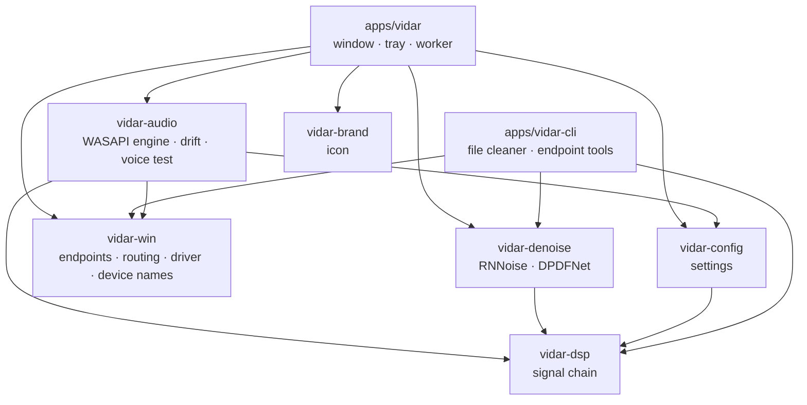

# Development

## Building

You need Windows 10 (1903 or later) or 11 on x86-64, or Windows 11 on ARM64,
[Rust](https://rustup.rs) (rustup picks up the pinned version from `rust-toolchain.toml`) and
the Visual Studio C++ build tools for your architecture. Builds are native: an ARM64 PC builds
the ARM64 package, and `cargo xtask fetch` picks the matching `onnxruntime.dll`.

The Rust programs link the C runtime statically (`.cargo/config.toml`), so they start without
the Microsoft Visual C++ Redistributable. Only `onnxruntime.dll` (Voice HD) needs it; setup
installs it when it is missing, and Voice HD falls back to Voice if it cannot load.

```shell
cargo xtask fetch        # RNNoise weights, the DPDFNet model, ONNX Runtime, each checked against SHA-256
cargo build --release    # target\release\vidar.exe and vidar-cli.exe
cargo test --workspace
```

`cargo xtask fetch` downloads into `third_party/rnnoise/model/`, `third_party/onnxruntime/`
and `third_party/dpdfnet/`. All three are git-ignored. It fetches only the default DPDFNet
model, `dpdfnet2_48khz_hr`; `cargo xtask fetch --all` also fetches the larger
`dpdfnet8_48khz_hr`.
Run the fetch before building or testing: the RNNoise build needs its weights, and
`cargo test --workspace` fails without the DPDFNet model and ONNX Runtime.

### Checking for newer components

```shell
cargo xtask outdated
```

compares every pinned component with its upstream and changes nothing: ONNX Runtime (NuGet),
both DPDFNet models and any new 48 kHz model (Hugging Face), the vendored RNNoise source and
its weights (xiph/rnnoise), the VB-CABLE driver pack (vb-audio.com), and the Rust crates that
`cargo update` would move. Each line says `[OK]`, `[NEW]` with what to change, or `[??]` when
a site could not be reached. It exits with 1 when something is newer. GitHub Actions pins are
kept current by Dependabot. Set `GITHUB_TOKEN` if GitHub's anonymous rate limit gets in the way.

Where they are looked for at run time:

- DPDFNet models: `--models-dir` (CLI only), the repo's `third_party/dpdfnet/` (development
  builds), `%VIDAR_MODELS_DIR%`, then `models\` next to the executable.
- `onnxruntime.dll`: `%ORT_DYLIB_PATH%`, next to the executable, then
  `third_party/onnxruntime/` in the repo.

To try the live app you also need the virtual cable. Start `vidar.exe` and press **Install
virtual microphone**, or run `vidar-cli endpoints install-driver` from an elevated prompt. It
looks for the driver in `drivers\vbcable` next to the executable. See
[How it works](how-it-works.md#the-virtual-cable) for why Vidar uses VB-Audio's signed driver
rather than its own.

## Releasing

Releases are built by [`.github/workflows/release.yml`](../.github/workflows/release.yml):

1. `cargo xtask changelog` previews the next release's notes. They come from the commit
   subjects since the last release ([cliff.toml](../cliff.toml)): `feat` under *New*, `fix`
   under *Fixed*, `perf` under *Faster*; everything else, and any scope `xtask`, `ci`,
   `build`, `deps`, `dev` or `release`, is left out. So write `feat:` and `fix:` subjects for
   users: what they will notice, not how it was done.
2. `cargo xtask release 0.3.0` (on a clean tree) sets the version in `Cargo.toml` and
   `Cargo.lock`, adds the `## 0.3.0` section to [CHANGELOG.md](../CHANGELOG.md), commits and
   tags `v0.3.0`. Reword the section if needed, amend, and move the tag. Needs git-cliff
   (`cargo install git-cliff --locked`).
3. Push: `git push origin main v0.3.0`.

The workflow checks that the tag matches the Cargo version, then builds on two runners,
`windows-latest` (x64) and `windows-11-arm` (ARM64). Each runs the tests and builds the package
and installer with `cargo xtask installer` (which needs cargo-about for
`licenses\THIRD_PARTY_LICENSES.html`, checked by the CI `cargo-about` job on every push, and
Inno Setup 6, installed on the runner). It publishes, each with its `.sha256`:

| | x64 | ARM64 |
|---|---|---|
| Setup | `vidar-<version>-x64-setup.exe` | `vidar-<version>-arm64-setup.exe` |
| Portable | `vidar-<version>-x64-portable.zip` | `vidar-<version>-arm64-portable.zip` |

The release notes are the version's CHANGELOG.md section (generated by git-cliff on the
runner if it is missing) plus the download instructions. Tags with a suffix (`v0.3.0-rc.1`)
become pre-releases, which the app's update check skips. To rebuild an existing tag, run the
workflow by hand (**Actions → Release → Run workflow**).

The app's updater relies on those asset names: it reads the latest release from the GitHub
API, downloads the setup for the PC (an ARM64 PC prefers the ARM64 setup, also from the
emulated x64 build, and falls back to x64), checks it against `<that>.sha256` and runs it
with `/SILENT /SUPPRESSMSGBOXES /NORESTART /RELAUNCH`. Keep the names: installed copies
depend on them. (Up to 0.3.0 the x64 setup was `vidar-<version>-setup.exe`; x64 copies
before 0.3.1 look only for that name, so they do not update to 0.3.1 or later by themselves.
The ARM64 name has not changed.)

### The installer

[installer/vidar.iss](../installer/vidar.iss) (Inno Setup 6) installs `dist\vidar` into
Program Files for all users, so one UAC prompt covers the program and the driver. Before it
replaces files, setup runs the new `vidar.exe --quit`: the running copy stops, gives the user's
microphone back and exits, and `--quit` waits for that (exit code 0 = gone, 1 = still running).
Restart Manager closes copies that do not answer. Uninstall does the same, removes the
*Start with Windows* entry, and asks about the driver and the settings. Never change its
`AppId`: that is how upgrades find the installation. The app counts as installed (and
updates itself) when `unins000.exe` sits next to `vidar.exe`.

One script builds both setups (`/DArch=x64` or `arm64`, passed by xtask). The ARM64 setup
needs Windows 11, because VB-CABLE's setup is an x64 program. When the Microsoft Visual C++
Redistributable (14.40 or later, for this architecture) is missing, setup downloads it from
`aka.ms/vs/17/release`, checks that Windows trusts its Microsoft signature, and installs it
quietly. If that fails it says so and goes on: Vidar works without it, only Voice HD needs it.

## Layout



| Path | What |
|---|---|
| `apps/vidar` | Desktop app: window (eframe), tray, background worker, autostart |
| `apps/vidar-cli` | File cleaner, plus the endpoint and driver tools the app runs elevated |
| `crates/vidar-dsp` | The chain: high-pass, gate, de-clicker, leveler, limiter, level meters |
| `crates/vidar-denoise` | RNNoise (compiled in from C, SSE4.1/AVX2 picked at run time) and DPDFNet (ONNX Runtime) |
| `crates/vidar-audio` | WASAPI capture/render engine, drift control, voice test |
| `crates/vidar-win` | Audio endpoints, default-device routing, cable renaming ("Vidar AI Microphone" / "Vidar Internal"), driver install |
| `crates/vidar-config` | Settings file and the engine parameters derived from it |
| `crates/vidar-brand` | The icon, drawn in code for the window, tray, `.ico` and the cable endpoints |
| `assets` | Inter font and the README icon |
| `tests/golden` | Reference recordings and expected output ([README](../tests/golden/README.md)) |
| `bench` | Quality benchmark ([benchmarks.md](benchmarks.md)) |
| `drivers/vbcable` | VB-Audio Virtual Cable driver pack, unmodified |
| `third_party/rnnoise` | Vendored RNNoise source ([README](../third_party/rnnoise/README.md)) |
| `installer` | Inno Setup script for `vidar-<version>-<arch>-setup.exe` (x64 or arm64) |
| `xtask` | `cargo xtask fetch`, `dist`, `installer`, `outdated` |

## Tests

- `cargo test --workspace` runs the unit tests plus the **golden tests**
  ([crates/vidar-denoise/tests/golden.rs](../crates/vidar-denoise/tests/golden.rs)). Five
  clips (clean speech, fan, keyboard, hiss and a loud voice) run through nine configurations,
  and every frame is compared with stored reference values. The bounds are about 1e-3
  (−65 dB) on levels and samples, loose enough for RNNoise picking scalar, SSE4.1 or AVX2
  code depending on the CPU, and the gate must make exactly the same open/close decisions.
  Any real change to how Vidar sounds makes them fail. If the change is intended, the vectors
  must be regenerated and the difference reviewed; see
  [tests/golden/README.md](../tests/golden/README.md).
- **Live tests** use the real default devices (muted). They are opt-in:

  ```shell
  set VIDAR_LIVE_TESTS=1
  cargo test -p vidar-audio --test live
  ```

- **Model speed**: `cargo run --release -p vidar-denoise --example bench [clip.wav]` times each
  model on its own. For figures comparable with [benchmarks.md](benchmarks.md), time
  `vidar-cli` as described there.

## Command line

```
vidar-cli --clean <file|folder> [output]    # clean recordings; folders run in parallel
vidar-cli --check-devices                   # what Windows sees right now
vidar-cli --install-driver                  # install the bundled virtual cable
vidar-cli endpoints <action>                # endpoint and driver tools, see below
```

Options for `--clean`:

| Option | Effect |
|---|---|
| `--engine rnnoise\|dpdfnet` | Model (default `dpdfnet`, falling back to `rnnoise` if it cannot load) |
| `--dpdfnet-vad rnnoise\|spectral` | Speech detector for DPDFNet (default `rnnoise`) |
| `--dpdfnet-model dpdfnet2_48khz_hr\|dpdfnet8_48khz_hr` | DPDFNet variant |
| `--no-fallback` | Fail instead of falling back to `rnnoise` when DPDFNet cannot load (used by the benchmark) |
| `--models-dir <dir>` | Folder with the DPDFNet `.onnx` files (default: `models\` next to the program) |
| `--no-model` | Filter and gate only (`--no-rnnoise` is an older alias) |
| `--no-gate` | Skip the gate |
| `--no-declick` | Skip the click suppressor after the noise model |
| `--gate-level input\|output` | Level the gate tracks: the input (default) or the model's output (experimental) |
| `--attn-limit-db <dB>` | Voice HD: the most the model may turn anything down (default: no limit) |
| `--auto-level` | Raise quiet speech |
| `--gain <dB>` | Make-up gain |
| `--stereo` | Keep stereo, gate both channels together |
| `--report-json <file>` | Per-frame speech probability and level (single file only) |
| `-j, --jobs <N>` | Files at once in folder mode (default: all cores) |

Input can be WAV, MP3, FLAC, Ogg Vorbis or AAC/M4A; in folder mode only files with those
extensions (`.wav`, `.mp3`, `.flac`, `.ogg`, `.m4a`) are picked up, and `*_cleaned` files
are skipped. The output is WAV. In folder mode the exit code is 1 if any file failed.

`endpoints` actions:

| Action | What it does |
|---|---|
| `list`, `report` | Active endpoints; default devices and cable status |
| `check-cable` | Exit code 0 if the cable is installed and active |
| `get-default-capture`, `get-cable-capture` | Print endpoint IDs |
| `set-default <id>` | Make an endpoint the default for all roles |
| `disable <id>` | Hide an endpoint; `--enable` turns it back on |
| `backup`, `restore` | Save and restore the default playback or recording device |
| `ensure-physical` | If the default device is virtual, switch to a physical one |
| `brand`, `unbrand` | Rename the cable to Vidar AI Microphone / Vidar Internal, or put the original names back |
| `install-driver`, `uninstall-driver` | Install the cable keeping the default devices, then rename it; or restore the original names and remove it |

`vidar-cli --help` and `vidar-cli endpoints --help` list everything.

## Settings file

Settings live in `%APPDATA%\Vidar\config.json`. If a `config.json` sits next to `vidar.exe` in
a writable folder, that one is used instead (portable mode). Unknown keys are kept, so newer
and older versions can share a file, except settings older versions wrote that are now fixed
in code (old gate and filter tuning, `dpdfnet_model` and the like): those are removed on load.
Hand-edited values are clamped to safe ranges on load.

| Key | Values | Default |
|---|---|---|
| `vad_threshold` | Strength: the gate's open threshold, 0.05–0.99 | `0.70` |
| `mic_boost_db` | Microphone boost, 0–30 dB | `0` |
| `auto_level` | Level quiet speech automatically | `false` |
| `eq_preset` | Voice tone: `off`, `warm`, `clear`, `broadcast`, `bright`, `soft`, `nasal`, `gaming`, `headset`, `laptop`, `close` or `custom` | `off` |
| `eq_custom_db` | Custom tone, seven band gains in dB (low shelf, 200 Hz, 500 Hz, 1 kHz, 2.5 kHz, 5 kHz, high shelf), ±12. Any other length reads as flat | `[0,0,0,0,0,0,0]` |
| `denoise_engine` | `dpdfnet` (Voice HD) or `rnnoise` (Voice); anything else reads as `rnnoise` | `dpdfnet` |
| `raw_capture` | Ask Windows for the mic signal without vendor "enhancements" | `false` |
| `start_with_windows` | Start at sign-in | `false` |
| `ui_theme` | `auto`, `light` or `dark` | `auto` |
| `check_updates` | Ask GitHub for the latest version about once a day | `true` |
| `last_update_check` | When the last automatic check ran (seconds since 1970) | `0` |
| `mic_profiles` | Mode, strength, boost and auto level last used with each microphone, by endpoint ID (with its name). The top-level values are those of the microphone in use | `{}` |
| `pause_when_unused` | Skip the noise model and send silence while no app records from Vidar AI Microphone | `true` |
| `cpu_fallback` | How far to step down while the processor cannot keep up: `off`, `voice` (Voice HD to Voice only) or `any` (down to the filter and gate alone) | `any` |
| `input_endpoint_id`, `input_device_name` | The chosen microphone (empty: the Windows default) | — |

Written by the app, not meant to be edited: `version`, `is_swapped` and `original_mic_id`
(crash recovery while the default mic is switched to the cable), `cable_capture_id` and
`cable_render_id`.

The cable's original names and icons are saved in `%ProgramData%\Vidar\endpoint-branding.tsv`
before it is renamed, so uninstalling can put them back.
