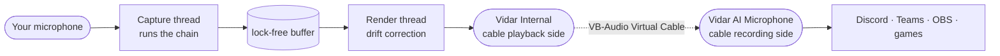
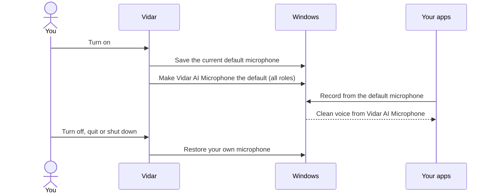

# How Vidar works

## The big picture

Vidar reads your microphone, cleans each 10 ms of audio, and plays the result into a virtual
audio cable. Apps record from the other end of that cable, which Windows lists as a normal
microphone.

## The virtual cable

### Why a cable, and not Vidar's own microphone driver

An app can only appear in Windows' microphone list through a **kernel-mode audio driver**. On
64-bit Windows 10 (1607 and later) and Windows 11 with Secure Boot on, Windows loads such a
driver only if Microsoft has signed it. Getting a driver signed means:

- an **Extended Validation (EV) code-signing certificate**, issued only to a registered
  company after identity checks, at several hundred dollars a year;
- a **Microsoft Partner Center hardware account**, tied to that certificate;
- submitting **every build** of the driver to Microsoft for attestation signing (or full WHQL
  testing for Windows Update distribution).

Commercial noise-cancellation apps ship their own signed driver and show up as a single
microphone. For a free, open-source project the certificate and the per-release signing are a
real barrier. Contributors also could not build a working driver themselves, because a
self-built driver will not load without test-signing mode.

Vidar therefore uses **[VB-Audio Virtual Cable](https://vb-audio.com/Cable/)**, a driver that is
already Microsoft-signed, widely used and free for personal use (donationware). It is bundled
unmodified in [drivers/vbcable](../drivers/vbcable).

### Why there are two devices

VB-Cable is a cable with two ends, and Windows shows both:

| Stock name | Vidar's name | Windows list | Who uses it |
|---|---|---|---|
| CABLE Input | **Vidar Internal** | Output (playback) | Only Vidar, which plays the clean voice into it |
| CABLE Output | **Vidar AI Microphone** | Input (recording) | Your apps |

Whatever is played into one end comes out of the other unchanged. The name *Vidar Internal*
says that this device is part of Vidar's plumbing, not a speaker:

- **Choosing it as speakers** gives silence, and puts that sound into the microphone the other
  side hears.
- **Disabling it** cuts Vidar AI Microphone off: the microphone stays listed but receives no
  audio.
- **Vidar never makes it the default output.** VB-Cable's own installer sometimes does; the
  install step immediately switches playback back to the best physical device
  (`ensure_physical_default` in [crates/vidar-win/src/router.rs](../crates/vidar-win/src/router.rs)).

### Installing and renaming

Installation runs `vidar-cli endpoints install-driver` once, elevated, behind a single UAC
prompt ([crates/vidar-win/src/driver.rs](../crates/vidar-win/src/driver.rs)). It:

1. saves the current default playback and recording devices;
2. runs `VBCABLE_Setup_x64.exe` silently;
3. restores both defaults, or picks the best physical device if they are gone;
4. renames the two ends and gives them Vidar's icon.

The renaming is there to make the two devices easier to understand. VB-Cable's stock names are
confusing: *CABLE Input* is a playback device and *CABLE Output* is a microphone, and neither
says what it is for. After renaming, the microphone list shows **Vidar AI Microphone**, the
one device to choose, and the playback list shows **Vidar Internal**, which says it is not for
you to use.

Renaming ([crates/vidar-win/src/branding.rs](../crates/vidar-win/src/branding.rs)) changes
only the endpoint description and icon. The interface name *VB-Audio Virtual Cable* comes from
the driver and stays as it is; that is also how Vidar recognises the cable after renaming.
The original names and icons are saved first to `%ProgramData%\Vidar\endpoint-branding.tsv`,
and **Uninstall** puts them back before removing the driver. Vidar also remembers both endpoint
IDs in the settings file, so it finds the cable even if someone renames it again.

## The signal chain

Every 10 ms (480 samples at 48 kHz, mono) one frame goes through `process_mono_frame` in
[crates/vidar-dsp/src/chain.rs](../crates/vidar-dsp/src/chain.rs). The live engine, the Test
tab and `vidar-cli` all use this same function, so a file you clean or a test you listen to
sounds exactly like the live microphone.

| # | Step | What it does | Default |
|---|---|---|---|
| 1 | Rumble filter | High-pass that removes desk thumps, AC hum and handling noise below the voice | on, 80 Hz |
| 2 | Pre-clip | Measures the input level, then gently rounds peaks above 75% so the model never sees hard clipping | always |
| 3 | AI model | Removes noise from under the voice and estimates the probability that you are speaking | Voice HD: DPDFNet (falls back to RNNoise) |
| 4 | De-clicker | Dips sharp keyboard clicks and thumps by 6-8 dB with a 1 ms envelope, so the dip itself does not click | always |
| 5 | Auto-level | Slowly raises quiet voices toward -24 dBFS, by up to +9 dB, at most 5 dB per second | off |
| 6 | Gain | Output gain × mic boost (× 1.2 for built-in laptop mics) | 1.08 |
| 7 | Gate | Turns the microphone down between phrases, so pauses stay quiet | always |
| 8 | Voice tone | Seven-band equaliser (100 Hz shelf, 200 Hz, 500 Hz, 1 kHz, 2.5 kHz, 5 kHz, 8 kHz shelf, ±12 dB): one of ten presets or a custom curve. After the model, so the model hears the natural voice | when not Off |
| 9 | Limiter | Soft limit at 85% of full scale, so Vidar AI Microphone never clips | always |

### What changes between modes

Only step 3 changes. Everything else is identical.

| | Voice | Voice HD |
|---|---|---|
| Noise removal | RNNoise | DPDFNet (ONNX Runtime) |
| Speech probability for the gate | RNNoise | RNNoise run alongside DPDFNet (default), or spectral |
| Model delay | 20 ms | 50 ms |
| Gate hold / release | 320 / 80 ms | 320 / 80 ms |

DPDFNet has no output that says whether you are speaking. Voice HD therefore either runs
RNNoise next to it purely for that probability (RNNoise's audio is discarded), or uses the
**spectral** detector, which measures how much speech-band energy DPDFNet kept. The probability
and level are delayed to match DPDFNet's longer delay, so the same gate tuning works for both
models.

Voice HD has two model files: `dpdfnet2_48khz_hr` (default) and the larger `dpdfnet8_48khz_hr`.
`cargo xtask fetch` downloads only the default; `cargo xtask fetch --all` also downloads the
larger one. If the DPDFNet model or ONNX Runtime cannot load, Voice HD falls back to RNNoise.

RNNoise is compiled in from C. On x86-64 it picks SSE4.1 or AVX2 network layers at run time,
whichever the processor supports, and falls back to plain code otherwise.

## The gate

The model leaves some residue in pauses: breaths, faint keyboard, distant voices. The gate
turns that down. It is in [crates/vidar-dsp/src/gate.rs](../crates/vidar-dsp/src/gate.rs).

- **Opens** when the speech probability passes the threshold (the strength). It also opens
  early on a weaker probability (0.35) together with a clear rise of 10 dB over the noise
  floor, so the first syllable is not cut.
- **Stays open** through word endings: a 320 ms hold after speech drops, plus an energy check
  that keeps it open while the level stays well above the floor.
- **Closes** below a lower threshold (hysteresis), so it does not flutter around one value.
  It turns down to 6% (about -24 dB), not to silence, so the room never sounds dead.
- **Learns the room**: it tracks the noise floor while you are silent, and calibrates on the
  first half second after start.
- **Never clicks**: every gain change is spread across the frame with a smooth curve.

### Strength

Strength is the gate's open threshold. The close threshold follows it at the same ratio.

| Strength | Opens at | Closes below |
|---|---|---|
| Gentle | 0.55 | 0.41 |
| Balanced (default) | 0.70 | 0.52 |
| Strong | 0.82 | 0.61 |

Settings → *Fine-tune* accepts any value in between.

## Routing

While Vidar AI Microphone is the default, the settings file records `is_swapped` and the
original microphone. The flag is written *before* Windows is changed, so if Vidar crashes or
the PC loses power, the next start sees it and restores your microphone before doing anything
else. Playback devices are never changed by routing.

If the microphone or the cable disappears, Vidar tries to reconnect, and asks you to press
Start if that fails. It finds the device by ID, or by name if Windows assigned a new ID.

## Two threads and clock drift

Capture (your microphone) and render (Vidar Internal) are two devices with two clocks that
never run at exactly the same speed. Over minutes, the buffer between them would slowly fill
up or run dry.

- The **capture thread** reads the microphone, runs the chain and pushes frames into a
  lock-free ring buffer.
- The **render thread** pulls from it into the cable. Once per callback it asks
  [drift control](../crates/vidar-audio/src/drift.rs) whether to drop or repeat a single
  sample to keep the buffer near its target. Real drift is under about 100 ppm, and one
  sample is inaudible.

Neither thread takes a lock or waits for the other. Apart from inference inside the DPDFNet
model, neither allocates memory on the audio path. That is what keeps the audio free of clicks
and dropouts.

## Where the delay comes from

| Source | Voice | Voice HD |
|---|---|---|
| Model | 20 ms | 50 ms |
| Audio buffers (capture + ring + render) | ~10 ms | ~10 ms |
| **Total** | **~30 ms** | **~60 ms** |

Vidar always asks Windows for the smallest buffer the devices allow, and falls back to the
regular shared-mode stream when a device cannot provide it (a format other than 48 kHz float,
a driver without the newer Windows audio interface, or a Bluetooth headset). *Raw microphone
signal* (off by default) asks Windows to skip the microphone driver's own effects, such as
built-in noise suppression or automatic volume, which can work against Vidar's processing.

## Saving work

- **Nobody listening.** Four times a second Vidar asks Windows whether any app is recording
  from Vidar AI Microphone (an active audio session on its endpoint). While none is, the
  capture thread sends silence and skips the model, after running it on silence for 80 ms so
  that resuming cannot replay old speech: the same path as Mute. It resumes on the next check
  after an app opens the microphone, so at most about a quarter of a second is silent.
  *Pause when no app is listening* in Settings turns this off.
- **Processor too busy.** Every frame's processing time is measured against its 10 ms. When the
  smoothed time stays above 80% of that, or more than one frame in ten is slow, for three
  seconds, Vidar switches to the next lighter mode (Voice HD, then Voice, then the filter and
  gate alone) and says so under Mode. After two minutes it tries the better mode again; if
  that is too much within ten minutes, the next wait doubles, up to half an hour. Choosing a
  mode yourself starts over.

## Settings for each microphone

Mode, strength, Boost and Auto level belong to the microphone: a laptop microphone, a USB
microphone and a Bluetooth headset need different values. Vidar keeps them per device
(`mic_profiles` in the settings file, by endpoint ID). Picking another microphone, or Windows
switching its default while Vidar is off, loads that microphone's values; a microphone used
for the first time starts from the current ones. Voice tone, the theme and the other settings
stay the same for every microphone.
